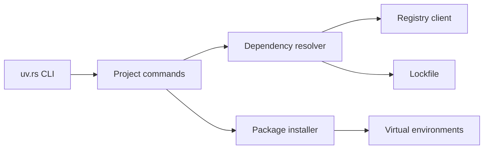

# astral-sh/uv

> Gestionnaire de paquets et de projets Python écrit en Rust, pour remplacer pip, poetry et pyenv.

## Le problème
Un projet Python mélange pip, virtualenv, pyenv et poetry, avec des résolutions lentes et peu reproductibles.

## Ce que ça fait vraiment
Un outil unique : projets avec fichier de verrouillage universel et espaces de travail, scripts avec métadonnées en ligne, outils (`uvx`), installation de versions de Python, interface compatible pip, build et publication. Un cache global déduplique les dépendances. Le README annonce un gain de 10 à 100 fois sur pip.

## Comment c'est branché


## Essayer
```bash
curl -LsSf https://astral.sh/uv/install.sh | sh
uv init example
uv add ruff
uv run ruff check
uvx pycowsay 'hello world!'
uv python install 3.12 3.13 3.14
```

## Coût et pièges
Gratuit. Le facteur de vitesse est annoncé par l'éditeur. Soutenu par Astral, société commerciale.

## Ce que ce n'est pas
Pas un gestionnaire d'environnements conda : pas de paquets non Python. Pas un orchestrateur de pipelines.

## Alternatives
Le README cite pip, pip-tools, pipx, poetry, pyenv, twine et virtualenv comme outils remplacés.

## Pour toi
À adopter : environnements reproductibles et installs rapides pour tes projets data et ML, avec un fichier de verrouillage versionnable.

