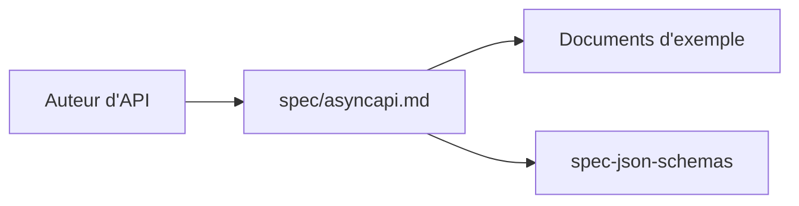

# asyncapi/spec

> The AsyncAPI specification, the description format for asynchronous and event-driven APIs.

## The problem
Message-based APIs (queues, event streams) have no standard contract comparable to OpenAPI, which complicates documentation and code generation.

## What it actually does
The specification repository: the Markdown file `spec/asyncapi.md` is the source of truth. It tracks the latest version (3.1.0) and keeps earlier versions linked. Sample documents are in `examples`. The JSON schemas are in another repository (spec-json-schemas).

## How it is wired


## Trying it
```bash
# aucune commande dans le README : lire spec/asyncapi.md et le dossier examples
```

## Cost and gotchas
Free, nothing to install. The specification is not software: to generate code or documentation you need the AsyncAPI tools, not described in this README.

## What it is not
Not a runtime, nor a generation tool, nor a message broker: only the text of the specification.

## Alternatives
No alternative named in the README.

## For you
Worth watching: useful for documenting event flows (Kafka, MQTT) in data pipelines, with no effect until you have such flows.
