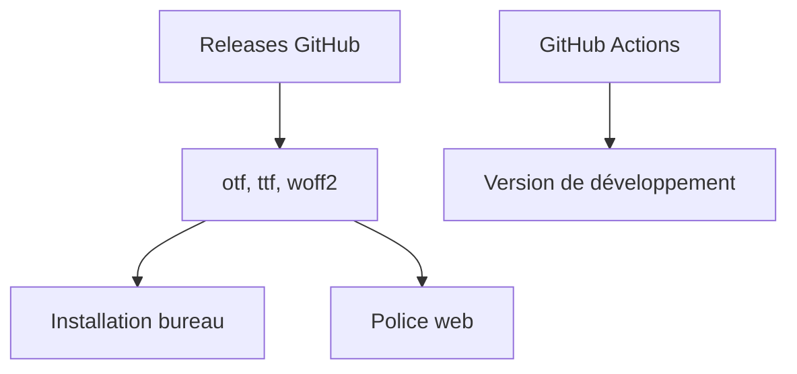

# atelier-anchor/smiley-sans

> Police chinoise « 得意黑 » (Smiley Sans), étroite et inclinée, pour affiches, titres et sous-titres vidéo.

## Le problème
Les polices chinoises courantes manquent de caractère pour les titres, affiches et textes d'écran.

## Ce que ça fait vraiment
Fournit une police au style de lettrage dessiné, avec 8 335 caractères chinois (GB/T 2312-1980 et Liste des caractères chinois standard), latin, cyrillique, grec, kana, chiffres et ponctuation. Quatre fichiers : `.otf`, `.ttf` pour le bureau, `.woff2` pour le web. Fonctions OpenType : fractions, chiffres tabulaires, variantes stylistiques.

## Comment c'est branché
Schéma simplifié d'après la fiche, sans diagramme fourni.


## Essayer
```bash
brew install font-smiley-sans
yay -S ttf-smiley-sans
```

## Coût et pièges
Gratuit, licence SIL OFL 1.1. Dernier push en décembre 2024. Les formes ne suivent pas strictement l'écriture normative de Chine continentale.

## Ce que ce n'est pas
Ce n'est pas une police pour du texte courant, du code ou des interfaces mobiles : le README la déconseille pour ces usages.

## Alternatives
Aucune alternative nommée dans le README.

## Pour toi
À ignorer : une police de titrage sans rapport avec le travail data / IA, sauf pour des visuels en chinois.

