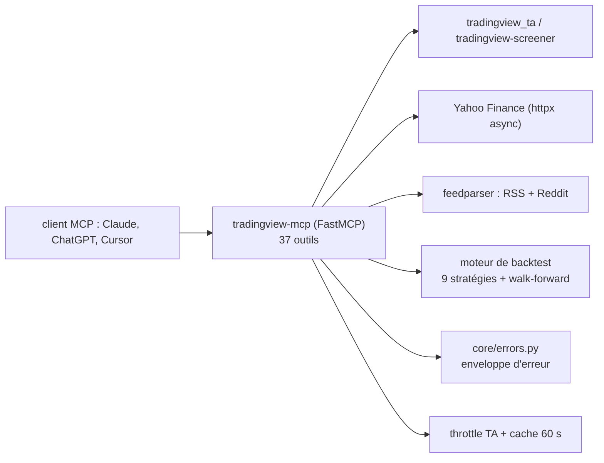

# atilaahmettaner/tradingview-mcp

> MCP server for market data, technical indicators, screeners and backtests for assistants.

## The problem
Asking an assistant for a technical analysis or a backtest means wiring up yourself a data
provider, an indicator library and a backtest engine, each with its own key.

## What it actually does
Exposes 37 MCP tools: full technical analysis (RSI, MACD, Bollinger, 23 indicators), weekly→15m
multi-timeframe analysis, multi-exchange screeners, a detector of 15 candlestick patterns, real-time
prices and a global snapshot via Yahoo Finance, Reddit sentiment and RSS feeds (Yahoo, MarketWatch,
CNBC, CoinDesk, CoinTelegraph). The backtest engine covers 9 strategies with simulated commission and
slippage, Sharpe/Calmar/Profit Factor/Expectancy metrics, a ranked comparison of the 9, and
walk-forward validation returning a ROBUST/MODERATE/WEAK/OVERFITTED verdict. Errors follow a
structured envelope (`code`, `retryable`) instead of strings, which distinguishes "no results
today" from an upstream rate limit. Seven hot tools were switched to `async`.

## How it is wired


## Trying it
```bash
pip install tradingview-mcp-server
git clone https://github.com/atilaahmettaner/tradingview-mcp && cd tradingview-mcp && uv run tradingview-mcp
uv tool install --python 3.13 tradingview-mcp-server
uv tool install tradingview-mcp-server
```
Claude Desktop configuration:
```json
{
  "mcpServers": {
    "tradingview": {
      "command": "uvx",
      "args": ["--python", "3.13", "--from", "tradingview-mcp-server", "tradingview-mcp"]
    }
  }
}
```

## Cost and gotchas
Self-hosting is free and MIT; the hosted version costs 9 or 29 $/month with a 3-day trial.
Python 3.14 is not supported: without pinning 3.13, the first launch exceeds the MCP timeout
(`error -32001`). Parallel calls can hit the upstream rate limit, hence the throttle.

## What it is not
Not a TradingView product: independent project, with no affiliation, which does not connect to a
TradingView account, does not scrape it and does not automate it. Not financial advice: the README
devotes a whole disclaimer to the fact that signals, entries, stops and targets are not
recommendations, that data may be delayed or wrong, and that the risk of loss is
substantial. Not an order executor.

## Alternatives
- `tradesdontlie/tradingview-mcp`: if you want to drive TradingView Desktop (Pine Script, drawings).

## For you
Good example of a polished MCP server (error envelopes, async, throttle); the domain is off to the side.
