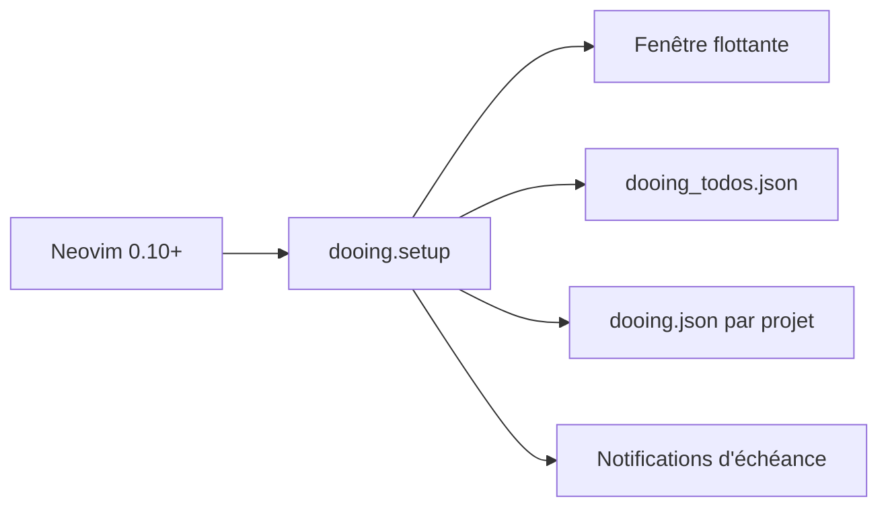

# atiladefreitas/dooing

> Minimalist floating-window task manager for Neovim.

## The problem
Keeping track of your tasks without leaving the editor or opening a separate application.

## What it actually does
Task list in a floating window, with `#tag` labels, priorities, due dates, subtasks, duration estimates, import and export. Per-project lists (JSON file at the root of the git repository). An optional "modern" style is available.

## How it is wired
Simplified diagram based on the sheet, no diagram provided.


## Trying it
```lua
vim.pack.add({ "https://github.com/atiladefreitas/dooing" })
require("dooing").setup({})
```
Commands: `:Dooing`, `:DooingLocal`, `:DooingDue`.

## Cost and gotchas
Free; Neovim 0.10 or later. Project tasks go in a file inside the repository: remember the `.gitignore` (option `auto_gitignore`).

## What it is not
Not a synchronization or team-work tool: local JSON files. No views by category (everything stays in the to-do list).

## Alternatives
No alternative named in the README.

## For you
Ignore, unless you live in Neovim: personal comfort, nothing for your data/AI work.
