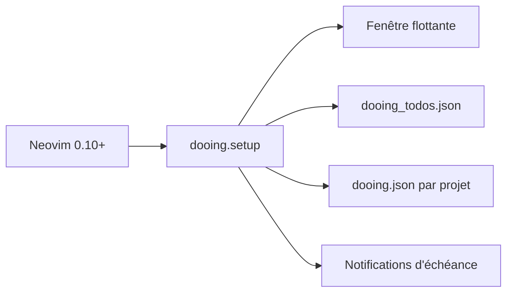

# atiladefreitas/dooing

> Gestionnaire de tâches minimaliste en fenêtre flottante pour Neovim.

## Le problème
Suivre ses tâches sans quitter l'éditeur ni ouvrir une application à part.

## Ce que ça fait vraiment
Liste de tâches dans une fenêtre flottante, avec étiquettes `#tag`, priorités, échéances, sous-tâches, estimations de durée, import et export. Listes par projet (fichier JSON à la racine du dépôt git). Un style « moderne » facultatif est disponible.

## Comment c'est branché
Schéma simplifié d'après la fiche, sans diagramme fourni.


## Essayer
```lua
vim.pack.add({ "https://github.com/atiladefreitas/dooing" })
require("dooing").setup({})
```
Commandes : `:Dooing`, `:DooingLocal`, `:DooingDue`.

## Coût et pièges
Gratuit ; Neovim 0.10 ou plus. Les tâches de projet vont dans un fichier du dépôt : penser au `.gitignore` (option `auto_gitignore`).

## Ce que ce n'est pas
Pas un outil de synchronisation ni de travail d'équipe : fichiers JSON locaux. Pas de vues par catégories (toujours dans la liste à faire).

## Alternatives
Aucune alternative nommée dans le README.

## Pour toi
À ignorer, sauf si tu vis dans Neovim : confort perso, rien pour ton travail data/IA.

