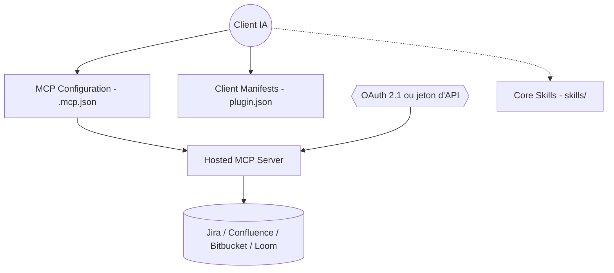

# atlassian/atlassian-mcp-server

> Configuration and skills to connect an AI assistant to Atlassian's hosted MCP server (Jira, Confluence, Bitbucket).

## The problem
Without a secure bridge, an assistant neither reads nor modifies your Atlassian tickets, pages and repositories without copy-pasting.

## What it actually does
The repository does not contain the server: it publishes plugin manifests (Claude Code, Cursor, Gemini, MCP Registry), skills (task capture, status report, sprint board, search, spec to backlog, ticket triage) and the config pointing to the hosted server `https://mcp.atlassian.com/v2/mcp`. Authentication goes through OAuth 2.1 or an API token, according to your existing permissions. Jira Service Management requires an API token.

## How it is wired


## Trying it
```bash
claude mcp add --transport http atlassian https://mcp.atlassian.com/v2/mcp
codex mcp add atlassian --url https://mcp.atlassian.com/v2/mcp
```
Then `/mcp` in Claude Code to authenticate.

## Cost and gotchas
You need an Atlassian Cloud site (subscription at your expense, prices not documented in the README). API token access must be enabled by an administrator. The SSE v1 endpoint is no longer supported since June 30, 2026. Prompt injection risk: favor minimal permissions.

## What it is not
Not the self-hostable server: it is in Atlassian's cloud. Does not bypass any existing permission.

## Alternatives
No alternative named in the README.

## For you
Worth watching if your team works on Jira and Confluence: official connection, but depends on a paid third-party service.
