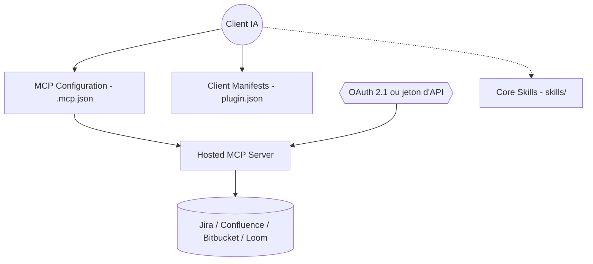

# atlassian/atlassian-mcp-server

> Configuration et skills pour brancher un assistant IA au serveur MCP hébergé d'Atlassian (Jira, Confluence, Bitbucket).

## Le problème
Sans pont sécurisé, un assistant ne lit ni ne modifie tes tickets, pages et dépôts Atlassian sans copier-coller.

## Ce que ça fait vraiment
Le dépôt ne contient pas le serveur : il publie les manifestes de plugin (Claude Code, Cursor, Gemini, MCP Registry), des skills (capture de tâches, rapport d'état, tableau de sprint, recherche, spec vers backlog, tri de tickets) et la config pointant sur le serveur hébergé `https://mcp.atlassian.com/v2/mcp`. L'authentification passe par OAuth 2.1 ou jeton d'API, selon tes droits existants. Jira Service Management exige un jeton d'API.

## Comment c'est branché


## Essayer
```bash
claude mcp add --transport http atlassian https://mcp.atlassian.com/v2/mcp
codex mcp add atlassian --url https://mcp.atlassian.com/v2/mcp
```
Puis `/mcp` dans Claude Code pour s'authentifier.

## Coût et pièges
Il faut un site Atlassian Cloud (abonnement à ta charge, tarifs non documentés dans le README). L'accès par jeton d'API doit être activé par un administrateur. Le point de terminaison SSE v1 n'est plus pris en charge depuis le 30 juin 2026. Risque d'injection de prompt : privilégier les droits minimaux.

## Ce que ce n'est pas
Pas le serveur auto-hébergeable : il est dans le cloud d'Atlassian. Ne contourne aucune permission existante.

## Alternatives
Aucune alternative nommée dans le README.

## Pour toi
À surveiller si ton équipe travaille sur Jira et Confluence : connexion officielle, mais dépend d'un service payant tiers.

