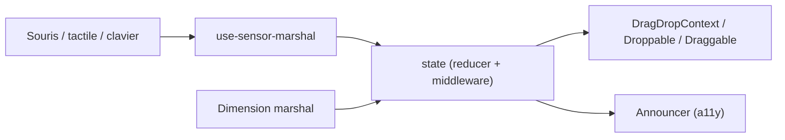

# atlassian/react-beautiful-dnd

> React drag-and-drop library for lists, with keyboard and screen reader accessibility, now archived.

## The problem
Native HTML5 drag and drop is inconsistent across browsers and ignores the keyboard and screen readers when reordering lists.

## What it actually does
Provides three components (DragDropContext, Droppable, Draggable) for vertical, horizontal, multi-list and nested lists. The internal code follows a Redux-like flow: mouse, touch and keyboard sensors, dimension marshal, impact computation, auto-scroll and an accessibility announcer. The sensors are extensible.

## How it is wired

## Trying it
No command in the README: installation is deferred to the documentation (docs folder).

## Cost and gotchas
Free, but the project is archived and deprecated on npm (last push on 2025-08-18), with 642 open issues. The license is not identified by GitHub.

## What it is not
It is not maintained: no fixes to expect. It does not cover cases beyond lists, unlike react-dnd, which the README cites.

## Alternatives
- Pragmatic drag and drop: successor proposed by Atlassian.
- react-dnd: broader primitives than the list-only case.

## For you
Ignore: archived and deprecated, and in any case a React UI component unrelated to data/AI; prefer Atlassian's successor.
