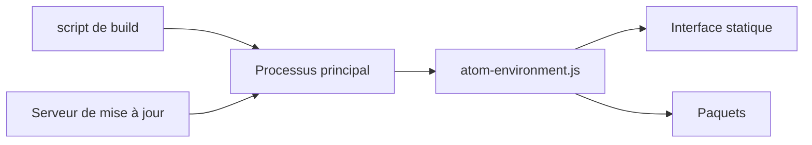

# atom/atom

> Extensible Electron-based text editor, discontinued and archived.

## The problem
Having an editor configurable through JavaScript and packages, at a time when few editors were.

## What it actually does
Atom is an Electron desktop editor whose core (`src`, main and render processes) loads packages provided in `packages`. It updates itself on macOS and Windows, and by archive on Linux. The README announces the repository's archiving on December 15, 2022; the catalog confirms: archived, last push 2023-01-03.

## How it is wired


## Trying it
```bash
tar xf atom-amd64.tar.gz
```
After installing the Ubuntu dependencies listed in the README.

## Cost and gotchas
Free, but no more updates or security fixes. On Linux, no automatic update.

## What it is not
It is not a living project: do not deploy it on a work machine.

## Alternatives
No alternative named in the README.

## For you
Ignore: archived repository, no fixes; pick a maintained editor.
