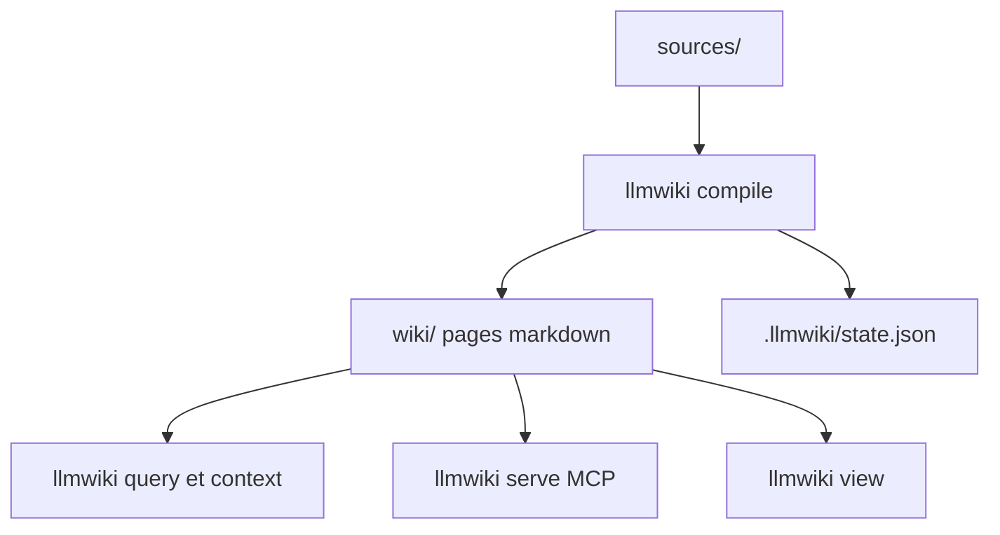

# atomicstrata/llm-wiki-compiler

> A compiler that turns raw sources into a cited markdown wiki, queryable by humans and agents.

## The problem
Querying mere document fragments forces the model to rebuild the relationships at every question, with no trace or review.

## What it actually does
It imports sources, an LLM extracts concepts from them, then generates typed markdown pages with citations (file and lines). Hybrid search (vectors, BM25, links), a review queue before publication, freshness check, local viewer, MCP server, TypeScript SDK, OKF, JSON and GraphML export. Configurable profiles define entities and workflows. An application of the "LLM Wiki" pattern described by Karpathy.

## How it is wired
Simplified diagram based on the sheet, no diagram provided.


## Trying it
```bash
npm install -g llm-wiki-compiler
export ANTHROPIC_API_KEY=sk-...
llmwiki quickstart ./notes.md
llmwiki query "what are the key ideas?"
llmwiki view --open
```

## Cost and gotchas
Node 24 or later. Each compilation calls an LLM (Anthropic by default, other providers possible including Ollama): token cost, mitigated by incremental compilation.

## What it is not
Not a static site generator nor an ontology database. The README admits it is still young software, poorly suited to very fast-changing data flows.

## Alternatives
No alternative named in the README.

## For you
To watch: an interesting approach for a cited, auditable knowledge base, with MCP and SDK, but young and billed in tokens.
