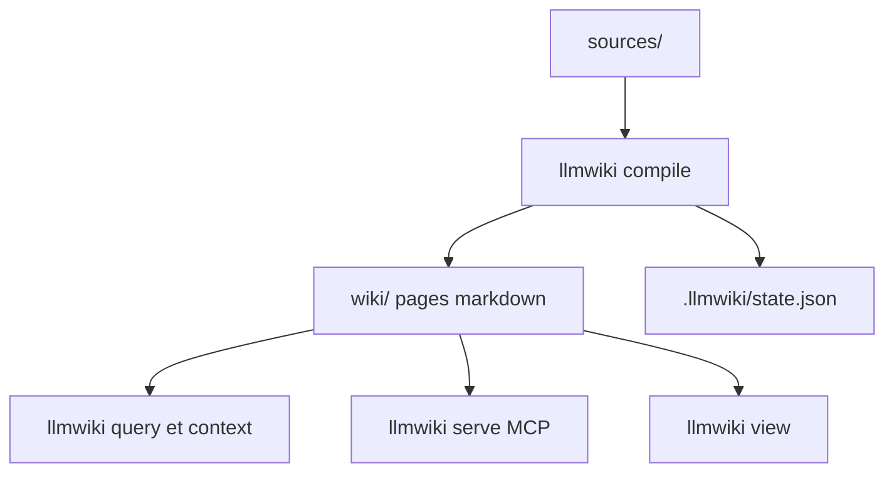

# atomicstrata/llm-wiki-compiler

> Un compilateur qui transforme des sources brutes en wiki markdown cité, interrogeable par humains et agents.

## Le problème
Interroger de simples fragments de documents oblige le modèle à reconstruire les relations à chaque question, sans trace ni relecture.

## Ce que ça fait vraiment
Il importe des sources, un LLM en extrait des concepts, puis génère des pages markdown typées avec citations (fichier et lignes). Recherche hybride (vecteurs, BM25, liens), file de relecture avant publication, contrôle de fraîcheur, visionneuse locale, serveur MCP, SDK TypeScript, export OKF, JSON et GraphML. Des profils configurables définissent entités et flux de travail. Application du motif « LLM Wiki » décrit par Karpathy.

## Comment c'est branché
Schéma simplifié d'après la fiche, sans diagramme fourni.


## Essayer
```bash
npm install -g llm-wiki-compiler
export ANTHROPIC_API_KEY=sk-...
llmwiki quickstart ./notes.md
llmwiki query "what are the key ideas?"
llmwiki view --open
```

## Coût et pièges
Node 24 ou plus. Chaque compilation appelle un LLM (Anthropic par défaut, autres fournisseurs possibles dont Ollama) : coût en jetons, atténué par la compilation incrémentale.

## Ce que ce n'est pas
Pas un générateur de site statique ni une base d'ontologies. Le README admet que ce reste un logiciel jeune, peu adapté aux flux de données très changeants.

## Alternatives
Aucune alternative nommée dans le README.

## Pour toi
À surveiller : approche intéressante pour une base de connaissances citée et auditable, avec MCP et SDK, mais jeune et facturée en jetons.

