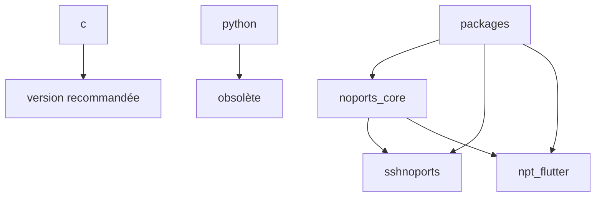

# atsign-foundation/noports

> Open source code of Atsign's NoPorts product: remote access over SSH, with Dart and C binaries and a Flutter app.

## The problem
Not documented in the README, which points to the product website and external documentation.

## What it actually does
The README only lists the repository contents: a packages folder with the shared Dart core, the command-line binaries (sshnp, npt, sshnpd, srvd), a Flutter desktop app, a C version and an obsolete Python version. The detailed operation is not documented here.

## How it is wired
Simplified diagram based on the sheet, no diagram provided.

## Trying it
No command documented in the README: installation and usage are on the documentation site.

## Cost and gotchas
Prerequisites not documented in the README. The Python implementation is obsolete: the C version is recommended.

## What it is not
Not a guide: the repository exists to audit the source code. Do not confuse the open source code with the commercial product described on the website.

## Alternatives
No alternative named in the README.

## For you
Watch: secure remote access could be used to reach GPU machines, but the README does not allow a judgment.
