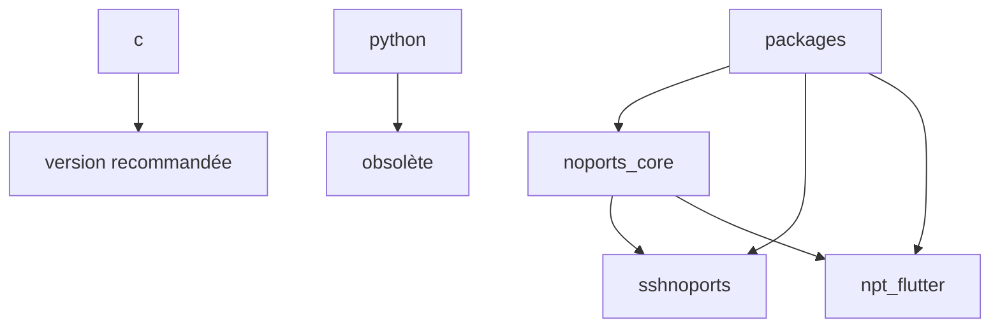

# atsign-foundation/noports

> Code ouvert du produit NoPorts d'Atsign : accès distant par SSH, avec binaires Dart, C et application Flutter.

## Le problème
Non documenté dans le README, qui renvoie au site du produit et à la documentation externe.

## Ce que ça fait vraiment
Le README liste seulement le contenu du dépôt : un dossier packages avec le cœur partagé en Dart, les binaires en ligne de commande (sshnp, npt, sshnpd, srvd), une application de bureau Flutter, une version en C et une version Python obsolète. Le fonctionnement détaillé est non documenté ici.

## Comment c'est branché
Schéma simplifié d'après la fiche, sans diagramme fourni.

## Essayer
Aucune commande documentée dans le README : installation et usage sont sur le site de documentation.

## Coût et pièges
Prérequis non documentés dans le README. L'implémentation Python est obsolète : la version C est recommandée.

## Ce que ce n'est pas
Pas un guide : le dépôt sert à auditer le code source. Ne pas confondre le code ouvert avec le produit commercial décrit sur le site.

## Alternatives
Aucune alternative nommée dans le README.

## Pour toi
À surveiller : l'accès distant sécurisé peut servir à atteindre des machines GPU, mais le README ne permet pas de juger.

