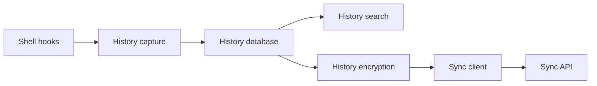

# atuinsh/atuin

> Shell history in SQLite with full-screen search and encrypted synchronization across machines.

## The problem
Shell history is a plain file, with no context, not shared between terminals or machines, and `ctrl-r` search on it is limited.

## What it actually does
A shell hook records every command with its exit code, duration, directory, host and session in SQLite. `ctrl-r` opens a full-screen search with filters (session, directory, global); usage statistics are computed. Synchronization is end-to-end encrypted, through the author's hosted server or your own. The old history file is not replaced. The code also contains a capture-and-resume feature for AI coding agent sessions, absent from the README.

## How it is wired


## Trying it
```bash
curl --proto '=https' --tlsv1.2 -LsSf https://setup.atuin.sh | sh
atuin register -u <USERNAME> -e <EMAIL>
atuin import auto
atuin sync
```

## Cost and gotchas
Free. The install command runs a remote script; signing up for Atuin's cloud is optional (sync can be disabled, or you can host the server). On Bash, `bash-preexec` has limitations.

## What it is not
Not a dotfiles manager nor a terminal multiplexer. Encryption protects the sync, not the local database.

## Alternatives
No alternative mentioned in the README.

## For you
Adopt: finding a long command (docker, kubectl, conda) across all your machines is a daily gain; you can stay offline without sync.
