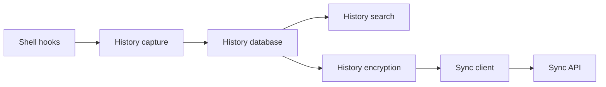

# atuinsh/atuin

> Historique de shell dans SQLite avec recherche plein écran et synchronisation chiffrée entre machines.

## Le problème
L'historique du shell est un simple fichier, sans contexte, non partagé entre terminaux ni machines, et la recherche `ctrl-r` y est limitée.

## Ce que ça fait vraiment
Un hook shell enregistre chaque commande avec code de retour, durée, répertoire, hôte et session dans SQLite. `ctrl-r` ouvre une recherche plein écran avec filtres (session, dossier, global) ; des statistiques d'usage sont calculées. La synchronisation est chiffrée de bout en bout, via le serveur hébergé par l'auteur ou le tien. L'ancien fichier d'historique n'est pas remplacé. Le code contient aussi un volet de capture et reprise de sessions d'agents de code IA, absent du README.

## Comment c'est branché


## Essayer
```bash
curl --proto '=https' --tlsv1.2 -LsSf https://setup.atuin.sh | sh
atuin register -u <USERNAME> -e <EMAIL>
atuin import auto
atuin sync
```

## Coût et pièges
Gratuit. La commande d'installation exécute un script distant ; l'inscription au cloud d'Atuin est facultative (sync désactivable, ou serveur à héberger). Sous Bash, `bash-preexec` a des limites.

## Ce que ce n'est pas
Pas un gestionnaire de dotfiles ni un multiplexeur de terminal. Le chiffrement protège la sync, pas la base locale.

## Alternatives
Aucune alternative citée dans le README.

## Pour toi
À adopter : retrouver une commande longue (docker, kubectl, conda) sur toutes tes machines est un gain quotidien ; tu peux rester hors ligne sans sync.

