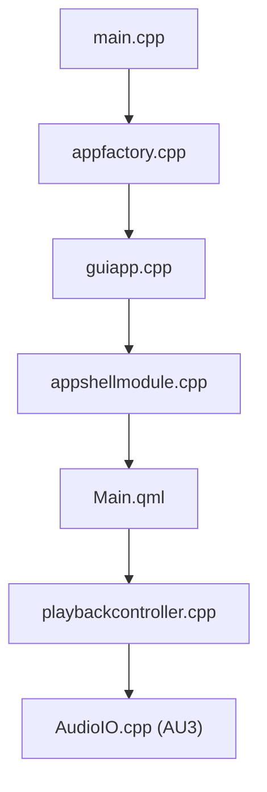

# audacity/audacity

> Cross-platform multitrack audio editor and recorder, undergoing a major overhaul toward Audacity 4.

## The problem
Editing, recording and processing sound on a desktop machine without commercial software.

## What it actually does
C++ application in the middle of migrating the historical engine and interface (AU3, wxWidgets) to a modular Qt/QML interface. The new modules wrap the AU3 engine: SQLite projects, tracks, playback and recording, effects (Nyquist, LV2, VST3, Audio Units), import/export, spectrograms. Audio.com integration and Crashpad/Sentry crash reporting exist.

## How it is wired

## Trying it
No command in the README: build instructions are deferred to external pages. Binaries are on the audacityteam.org site.

## Cost and gotchas
Free. The `master` branch is unstable: Audacity 4 is under construction and contributions to version 3.x go through the `audacity3` branch.

## What it is not
Not an audio library nor a machine learning tool. The license is not identified by GitHub: check before any derivative use.

## Alternatives
No alternative named in the README.

## For you
Ignore for your line of work: a desktop audio editor, useful for occasional troubleshooting, unrelated to data or AI pipelines.
