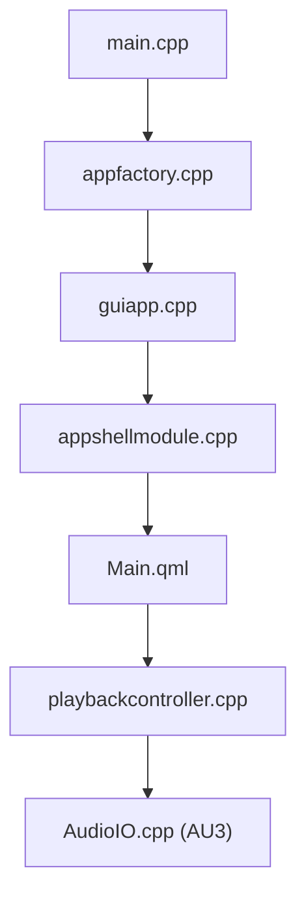

# audacity/audacity

> Éditeur et enregistreur audio multipiste multiplateforme, en pleine refonte vers Audacity 4.

## Le problème
Éditer, enregistrer et traiter du son sur un poste de bureau sans logiciel commercial.

## Ce que ça fait vraiment
Application C++ en cours de migration du moteur et de l'interface historiques (AU3, wxWidgets) vers une interface Qt/QML modulaire. Les nouveaux modules enveloppent le moteur AU3 : projets SQLite, pistes, lecture et enregistrement, effets (Nyquist, LV2, VST3, Audio Units), import/export, spectrogrammes. L'intégration Audio.com et le rapport de plantages Crashpad/Sentry existent.

## Comment c'est branché

## Essayer
Aucune commande dans le README : les instructions de compilation sont renvoyées à des pages externes. Les binaires sont sur le site audacityteam.org.

## Coût et pièges
Gratuit. La branche `master` est instable : Audacity 4 est en chantier et les contributions à la version 3.x passent par la branche `audacity3`.

## Ce que ce n'est pas
Pas une bibliothèque audio ni un outil de machine learning. La licence n'est pas identifiée par GitHub : à vérifier avant tout usage dérivé.

## Alternatives
Aucune alternative nommée dans le README.

## Pour toi
À ignorer pour ton métier : éditeur audio de bureau, utile en dépannage ponctuel, sans lien avec les pipelines data ou IA.

