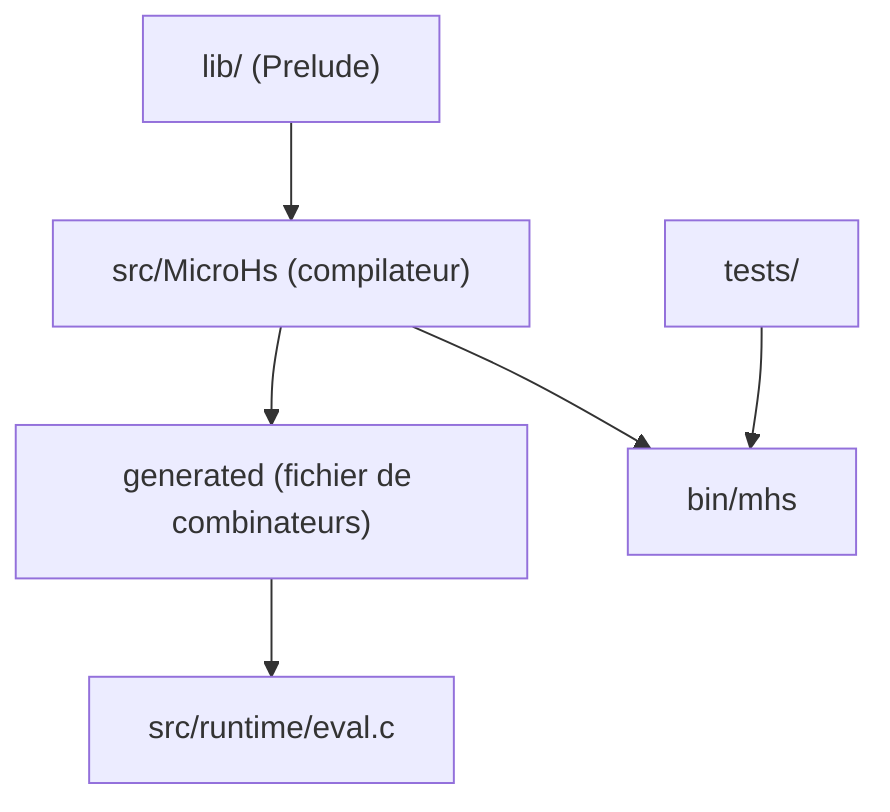

# augustss/MicroHs

> Implementation of an extended subset of Haskell, run by combinators, for compiler and microcontroller enthusiasts.

## The problem
GHC is heavy; the goal is a small, self-bootstrapping Haskell compiler that even runs on a microcontroller.

## What it actually does
The compiler compiles itself; a minimal C runtime executes the code by combinator reduction. It only needs a C compiler (combinator file provided). It offers an interactive mode, cross-compilation, a boards/ folder (STM32), JavaScript or WASM output via emscripten, and a partial base library.

## How it is wired
Simplified diagram based on the sheet, no diagram provided.


## Trying it
```bash
make
bin/mhs Example -oEx
./Ex
make minstall
make runtest
```

## Cost and gotchas
Free. A C compiler is enough; GHC is optional. The default Integer is slow (GMP possible). Several Haskell packages require the cpphs preprocessor.

## What it is not
Not a full GHC replacement: `Foldable` and `Traversable` are not in the Prelude, and the error messages are described as "bad" by the author. The module search section is marked as not implemented.

## Alternatives
No alternative cited in the README (GHC and Hugs are mentioned as reference compilers).

## For you
Watch: interesting for understanding a minimal functional compiler, but with no direct use in data or MLOps.
