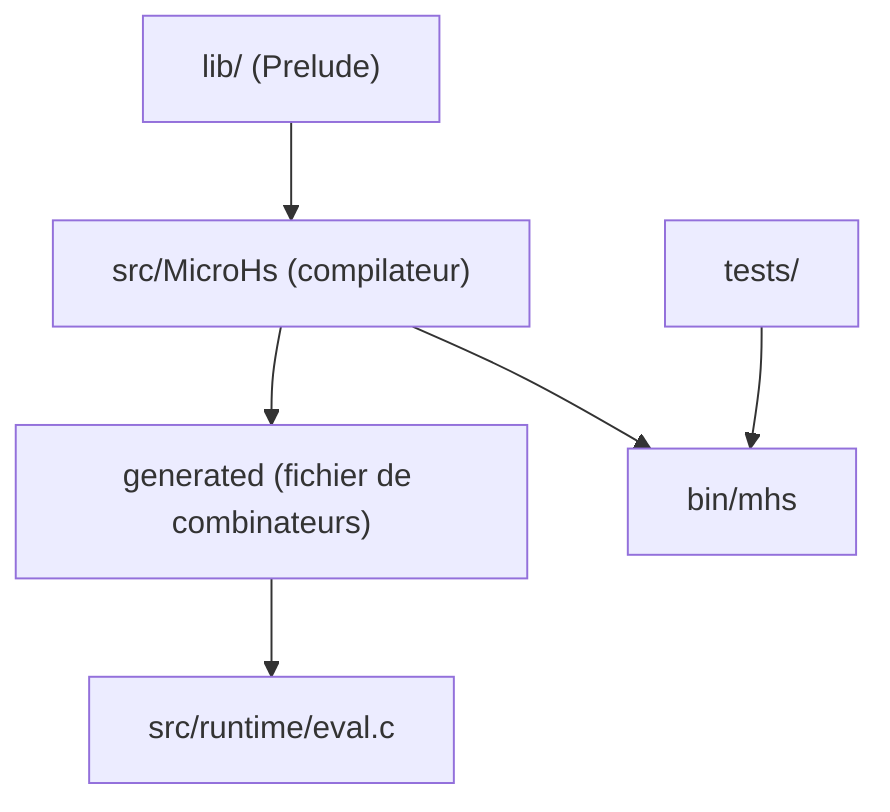

# augustss/MicroHs

> Implémentation d'un sous-ensemble étendu de Haskell, exécuté par combinateurs, pour curieux de compilateurs et de microcontrôleurs.

## Le problème
GHC est lourd ; on veut un compilateur Haskell petit, auto-amorçable, qui tourne même sur microcontrôleur.

## Ce que ça fait vraiment
Le compilateur se compile lui-même ; un runtime minimal en C exécute le code en réduction de combinateurs. Il demande seulement un compilateur C (fichier de combinateurs fourni). Il propose un mode interactif, la compilation croisée, un dossier boards/ (STM32), une sortie JavaScript ou WASM via emscripten, et une bibliothèque de base partielle.

## Comment c'est branché
Schéma simplifié d'après la fiche, sans diagramme fourni.


## Essayer
```bash
make
bin/mhs Example -oEx
./Ex
make minstall
make runtest
```

## Coût et pièges
Gratuit. Un compilateur C suffit ; GHC est optionnel. L'Integer par défaut est lent (GMP possible). Plusieurs paquets Haskell demandent le préprocesseur cpphs.

## Ce que ce n'est pas
Pas un remplaçant complet de GHC : `Foldable` et `Traversable` ne sont pas dans le Prelude, et les messages d'erreur sont qualifiés de « bad » par l'auteur. La section sur la recherche de modules est notée comme non implémentée.

## Alternatives
Aucune alternative citée dans le README (GHC et Hugs sont mentionnés comme compilateurs de référence).

## Pour toi
Surveiller : intéressant pour comprendre un compilateur fonctionnel minimal, mais sans usage direct en data ou MLOps.

