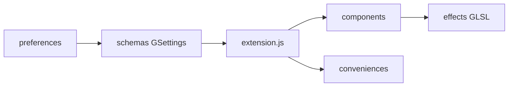

# aunetx/blur-my-shell

> GNOME Shell extension that applies a blur to the panel, the dock, the overview and windows.

## The problem
GNOME Shell offers no configurable blur effect for its interface elements.

## What it actually does
Applies a static blur (background image passed through effect pipelines: Gaussian, Monte Carlo, pixelation, corners) or a dynamic one (blur of what is behind) on the panel, Dash to Dock, the overview, app folders, popups, the lock screen and chosen applications. Settings handle artifacts. Compatible with Dash to Panel, Just Perfection and other extensions.

## How it is wired


## Trying it
```bash
git clone https://github.com/aunetx/blur-my-shell
cd blur-my-shell
make install
```

## Cost and gotchas
Free. The blur can slow down GNOME Shell (Monte Carlo with many iterations, "No artifact" option). Multiple monitors: handling may be incorrect.

## What it is not
Not a complete theme: blur only. Works only under GNOME Shell.

## Alternatives
No alternative named in the README.

## For you
Ignore: Linux desktop cosmetics, unrelated to your work.
