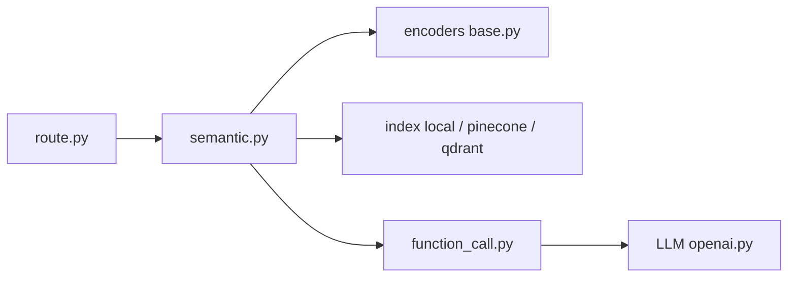

# aurelio-labs/semantic-router

> Semantic-similarity decision layer that routes requests before calling an LLM.

## The problem
Letting an LLM decide which tool or path to take is slow and expensive.

## What it actually does
You define `Route`s with example utterances, choose an encoder (Cohere, OpenAI, Hugging Face, FastEmbed, multimodal) and a `SemanticRouter`. A request is compared to the routes by similarity and returns the route name, or `None` when nothing matches. Variants: hybrid router, dynamic routes with LLM parameter extraction, threshold optimization, local indexes, Pinecone, Qdrant or Postgres.

## How it is wired


## Trying it
```bash
pip install -qU semantic-router
pip install -qU "semantic-router[local]"
pip install -qU "semantic-router[hybrid]"
```
The README then shows the route definition and `SemanticRouter(encoder=encoder, routes=routes, auto_sync="local")`.

## Cost and gotchas
Each remote encoder is billed per call (Cohere, OpenAI). A local version exists with `HuggingFaceEncoder` and `LlamaCppLLM`. The README mixes old names (`RouteLayer`) and recent ones (`SemanticRouter`).

## What it is not
Not an agent: it decides on a route, it executes nothing. Quality depends on your example utterances and your thresholds.

## Alternatives
No alternative cited in the README.

## For you
Keep an eye on it: a simple and fast building block to filter or steer requests before an LLM, to be tested on your own intents.
