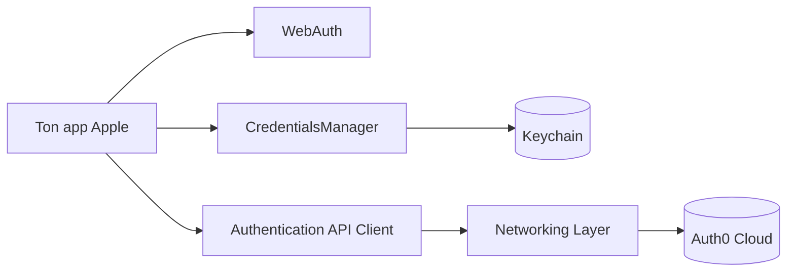

# auth0/Auth0.swift

> Swift SDK to authenticate users with Auth0 in iOS, macOS, tvOS, watchOS and visionOS apps.

## The problem
Integrating secure login (universal login, token storage, renewal, MFA) into an Apple app requires a lot of sensitive code.

## What it actually does
Provides `WebAuth` (universal login page with PKCE), an authentication API client, an MFA client (early access), a `CredentialsManager` that stores tokens in the Keychain and renews them, and local JWT/JWK validation. Compatible with callbacks, async/await and Combine. v3 brings breaking changes.

## How it is wired


## Trying it
```bash
npx skills add auth0/agent-skills --skill auth0
pod install
carthage bootstrap --use-xcframeworks
```
Swift Package Manager installation via Xcode with the URL `https://github.com/auth0/Auth0.swift`.

## Cost and gotchas
You need an Auth0 account and a Native-type application (Client ID and Domain). Universal Links require a paid Apple developer account. Xcode 26 and Swift 6.0+ required.

## What it is not
Not an identity server: it depends on the Auth0 service. MFA and IPSIE expiry are in early access.

## Alternatives
The README names no alternative.

## For you
Ignore: mobile authentication SDK tied to a SaaS, unrelated to data/AI/MLOps work.
