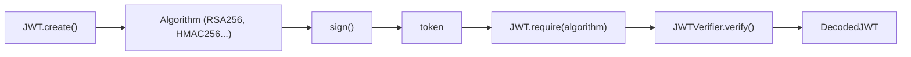

# auth0/java-jwt

> Java library to create and verify JWT tokens on the JVM server side.

## The problem
Signing and verifying JWT tokens by hand in Java is a source of security errors.

## What it actually does
It creates a JWT with `JWT.create()` then `sign(algorithm)`, and verifies it with a `JWTVerifier` that checks signature and claims. It supports HMAC, RSA, RSA-PSS and ECDSA. A `JWTVerificationException` is thrown if the token is invalid.

## How it is wired

Simplified diagram based on the sheet, no diagram provided.

## Trying it
```bash
# Maven : ajouter la dépendance com.auth0:java-jwt:4.6.2 au pom.xml
# Gradle :
implementation 'com.auth0:java-jwt:4.6.2'
```

## Cost and gotchas
Free. A JVM is required (Java LTS 8, 11, 17 or 21), not covered by the prerequisites list. On Java 8, RSASSA-PSS requires an external security provider; the JVM vulnerability CVE-2022-21449 affects ECDSA.

## What it is not
Not an authentication server and not suited to Android (the README points to JWTDecode.Android).

## Alternatives
- JWTDecode.Android: for Android applications.

## For you
Ignore: Java authentication library, unrelated to data / AI / MLOps work, unless you are building a JVM API.
