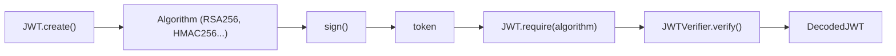

# auth0/java-jwt

> Bibliothèque Java pour créer et vérifier des jetons JWT côté serveur JVM.

## Le problème
Signer et vérifier des jetons JWT à la main en Java est une source d'erreurs de sécurité.

## Ce que ça fait vraiment
Elle crée un JWT avec `JWT.create()` puis `sign(algorithm)`, et le vérifie avec un `JWTVerifier` qui contrôle signature et claims. Elle gère HMAC, RSA, RSA-PSS et ECDSA. Une `JWTVerificationException` est levée si le jeton est invalide.

## Comment c'est branché

Schéma simplifié d'après la fiche, sans diagramme fourni.

## Essayer
```bash
# Maven : ajouter la dépendance com.auth0:java-jwt:4.6.2 au pom.xml
# Gradle :
implementation 'com.auth0:java-jwt:4.6.2'
```

## Coût et pièges
Gratuit. Il faut une JVM (Java LTS 8, 11, 17 ou 21), non couvert par la liste des prérequis. Sur Java 8, RSASSA-PSS demande un fournisseur de sécurité externe ; la faille CVE-2022-21449 de la JVM touche ECDSA.

## Ce que ce n'est pas
Pas un serveur d'authentification et pas adapté à Android (le README renvoie à JWTDecode.Android).

## Alternatives
- JWTDecode.Android : pour les applications Android.

## Pour toi
À ignorer : bibliothèque Java d'authentification, sans lien avec un travail data / IA / MLOps, sauf si tu bâtis une API JVM.

