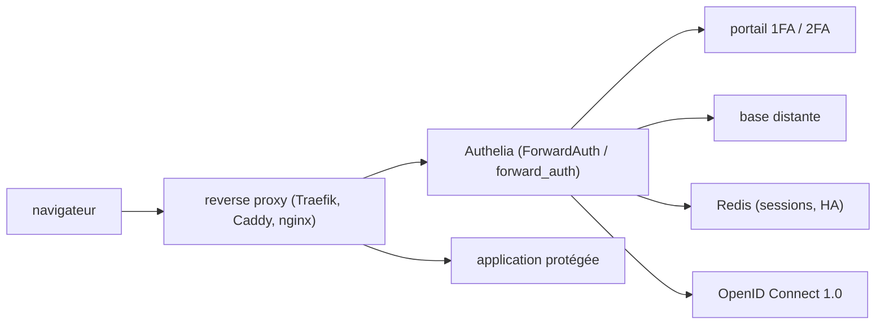

# authelia/authelia

> Authentication and SSO server that sits behind a reverse proxy to protect applications.

## The problem
Each self-hosted application reimplements its own login, with no second factor or shared policy.
Protecting a service with no native authentication forces you to hack things together at the proxy level.

## What it actually does
Web authentication portal: the reverse proxy delegates each request to it, and it is allowed, denied or redirected.
Choice of second factor: FIDO2/WebAuthn keys, TOTP, Duo push notifications, passwordless passkeys.
Fine-grained access rules by subdomain, user, group, URI, method and network; one- or two-factor policy per rule.
Certified OpenID Connect 1.0 / OAuth 2.0 provider (Basic, Implicit, Hybrid, Form Post, Config profiles), post-quantum cryptography.

## How it is wired

## Trying it
No install command is written in the README: it points to AUR, APT, FreeBSD Ports, static binary, .deb package, Docker, Kubernetes and the Helm chart (beta), plus the Local and Lite `docker compose` bundles.

## Cost and gotchas
The Local bundle uses self-signed certificates; the Lite bundle requires domains, DNS and LetsEncrypt to be configured.
High availability requires a remote database and Redis: the Lite configuration (file + SQLite) does not scale.

## What it is not
It is not exposed directly to the Internet: your reverse proxies are, and Authelia remains the internal control plane.
It is not version-stable: the project warns of breaking changes and recommends pinning a tag rather than `latest`.
OpenID Connect support is still announced as beta despite the certification.

## Alternatives
SWAG (LinuxServer): turnkey configuration that bundles Authelia, if you are starting from scratch.

## For you
Off-topic for data/AI, unless you expose internal apps yourself (MLflow, Label Studio) behind a proxy.
