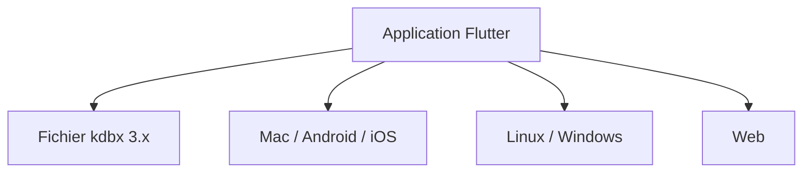

# authpass/authpass

> Flutter password manager compatible with KeePass 2.x (kdbx 3.x) for mobile, desktop and web.

## The problem
A KeePass vault without a comfortable application on every system.

## What it actually does
Flutter application that opens KeePass files (kdbx 3.x) on Mac, Android, iOS, Linux, Windows and in the browser. The README does not detail the features; it lists the app stores and ways to contribute.

## How it is wired
Simplified diagram based on the sheet, no diagram provided.



## Trying it
```bash
# README : aucune commande. Installation par les magasins (App Store, Google Play,
# Snapcraft, Flathub, Microsoft Store) ou la page des releases.
```

## Cost and gotchas
Free, donations accepted. GPL-3.0 license (copyleft). 171 open issues. For a password manager, you would have to verify the security model yourself, as it is absent from the README.

## What it is not
Not a synchronization service nor a server: a client application on kdbx files.

## Alternatives
No alternative named in the README.

## For you
Ignore: a password manager is not a data/AI watch topic; choose one whose audit is documented.
