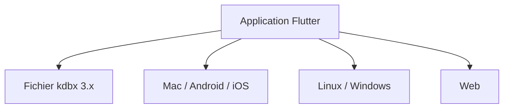

# authpass/authpass

> Gestionnaire de mots de passe Flutter compatible KeePass 2.x (kdbx 3.x) pour mobile, bureau et web.

## Le problème
Un coffre KeePass sans application confortable sur tous les systèmes.

## Ce que ça fait vraiment
Application Flutter qui ouvre des fichiers KeePass (kdbx 3.x) sur Mac, Android, iOS, Linux, Windows et navigateur. Le README ne détaille pas les fonctionnalités ; il liste les magasins d'applications et les moyens de contribuer.

## Comment c'est branché
Schéma simplifié d'après la fiche, sans diagramme fourni.



## Essayer
```bash
# README : aucune commande. Installation par les magasins (App Store, Google Play,
# Snapcraft, Flathub, Microsoft Store) ou la page des releases.
```

## Coût et pièges
Gratuit, dons acceptés. Licence GPL-3.0 (copyleft). 171 issues ouvertes. Pour un gestionnaire de mots de passe, il faudrait vérifier soi-même le modèle de sécurité, absent du README.

## Ce que ce n'est pas
Pas un service de synchronisation ni un serveur : une application cliente sur fichiers kdbx.

## Alternatives
Aucune alternative nommée dans le README.

## Pour toi
À ignorer : un gestionnaire de mots de passe n'est pas un sujet de veille data/IA ; choisis-en un dont l'audit est documenté.

