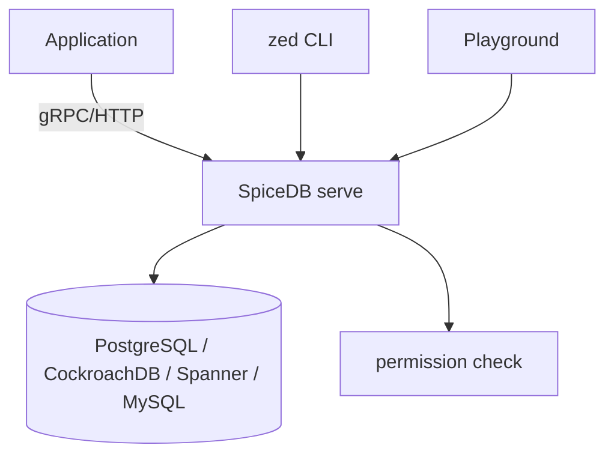

# authzed/spicedb

> Open-source authorization database inspired by Google's Zanzibar.

## The problem
Broken access control is the #1 OWASP 2021 risk. Coding "can X do Y on Z?" in every microservice leads to scattered, inconsistent rules that cannot be queried in reverse.

## What it actually does
Like a relational database: you define a **schema**, write **relations**, then clients run **permission checks**. Also answers "what can X do?" and "who can access Z?" via reverse indexes. Consistency configurable per request. Purely authorization, agnostic of authentication. Datastores: Spanner, CockroachDB, MySQL, PostgreSQL.

## How it is wired


## Trying it
```shell
brew install authzed/tap/spicedb authzed/tap/zed
```
```shell
docker run --rm -p 50051:50051 -p 8443:8443 authzed/spicedb serve --http-enabled true --grpc-preshared-key "somerandomkeyhere"
```

## Cost and gotchas
Free open-source core; AuthZed Cloud is the paid managed service. Anonymous telemetry, opt-out (`--telemetry-endpoint=""`). Requires a production datastore.

## What it is not
Not an identity provider: it does not handle authentication. Not a general-purpose database: dedicated to authorization relations.

## Alternatives
Not named in the README (it points to the Zanzibar paper as a reference, not to competitors).

## For you
Worth knowing if you build a multi-service platform with centralized fine-grained authorization; otherwise outside direct data/AI scope.
