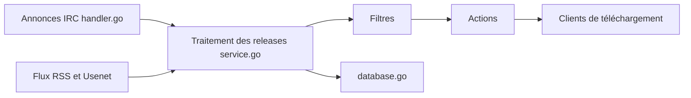

# autobrr/autobrr

> Torrent and Usenet download automation: watches trackers' IRC announcements and sends filtered files to clients.

## The problem
RSS feeds are too slow to join a torrent's initial swarm and maintain ratio on private trackers.

## What it actually does
Listens to indexers' IRC channels, applies filters (regex possible) then triggers actions: send to qBittorrent, Deluge, rTorrent, Transmission, the *arr apps, SABnzbd/NZBGet, watch folder, script or webhook. Also handles RSS, Torznab, Newznab, notifications, authentication (built-in or OIDC) and SQLite or PostgreSQL.

## How it is wired


## Trying it
```bash
docker compose up -d
brew install autobrr
brew services start autobrr
```
(The `docker-compose.yml` is given in the README with the image `ghcr.io/autobrr/autobrr:latest`, port 7474.)

## Cost and gotchas
Free. You need accounts on trackers and a client. The distroless image has no shell: `exec` scripts in bash do not work. By default it listens on 127.0.0.1; plan for a reverse proxy.

## What it is not
Neither a torrent client nor an indexer. The README does not address the legality of the downloaded content. GPL-2.0 license (copyleft).

## Alternatives
Radarr and Sonarr (via RSS) are cited as complementary tools, slower for the initial swarm.

## For you
Ignore: unrelated to data/AI/MLOps, it is a personal seedbox tool.
