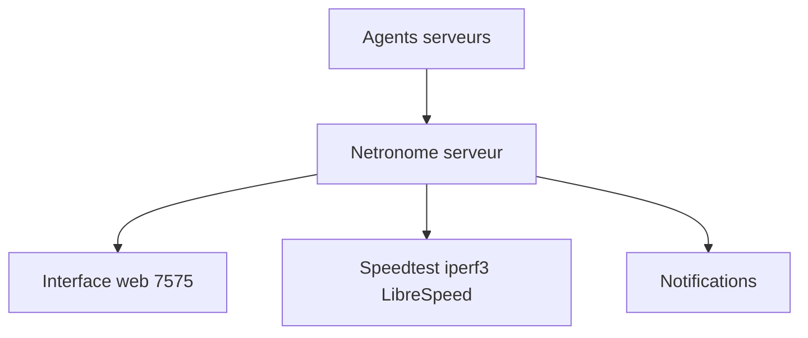

# autobrr/netronome

> Speed test and network monitoring server, with agents, in a single binary.

## The problem
Measuring throughput and monitoring servers requires several separate tools.

## What it actually does
Tests throughput with Speedtest.net, iperf3 or LibreSpeed, traces routes, monitors packet loss and DNS resolvers. Agents on your servers report system and bandwidth data. A notification is sent when a threshold is exceeded. A single binary contains the server, web interface and agent.

## How it is wired
Simplified diagram based on the sheet, no diagram provided.


## Trying it
```bash
git clone https://github.com/autobrr/netronome.git
cd netronome
docker compose -f distrib/docker/docker-compose.yml run --rm netronome generate-config
docker compose -f distrib/docker/docker-compose.yml up -d
```
Then open `http://localhost:7575`.

## Cost and gotchas
Free. Documentation is at netrono.me. Speed tests consume bandwidth.

## What it is not
Not an application observability tool (traces, logs). The short README details neither notification channels nor thresholds.

## Alternatives
No alternative named in the README.

## For you
Keep an eye on it: useful for monitoring the network of a cluster or a home lab of GPU machines, not for the model side.
