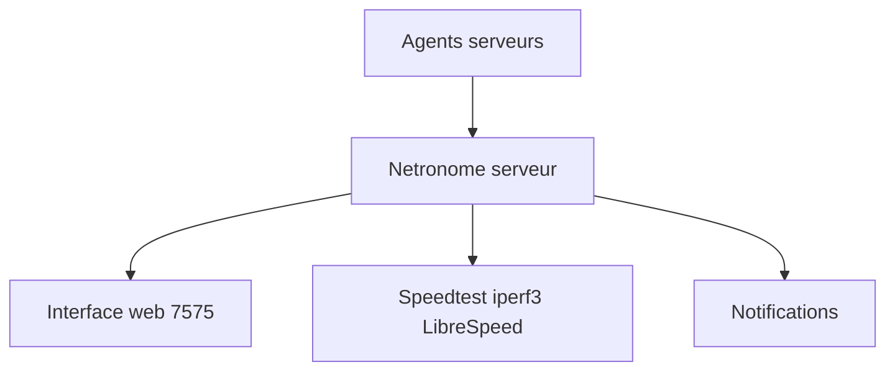

# autobrr/netronome

> Serveur de tests de débit et de supervision réseau, avec agents, en un binaire.

## Le problème
Mesurer le débit et suivre des serveurs demande plusieurs outils séparés.

## Ce que ça fait vraiment
Teste le débit avec Speedtest.net, iperf3 ou LibreSpeed, trace les routes, surveille la perte de paquets et les résolveurs DNS. Des agents sur tes serveurs remontent système et bande passante. Une notification part quand un seuil est dépassé. Un seul binaire contient serveur, interface web et agent.

## Comment c'est branché
Schéma simplifié d'après la fiche, sans diagramme fourni.


## Essayer
```bash
git clone https://github.com/autobrr/netronome.git
cd netronome
docker compose -f distrib/docker/docker-compose.yml run --rm netronome generate-config
docker compose -f distrib/docker/docker-compose.yml up -d
```
Puis ouvrir `http://localhost:7575`.

## Coût et pièges
Gratuit. La documentation est sur netrono.me. Les tests de débit consomment de la bande passante.

## Ce que ce n'est pas
Pas un outil d'observabilité applicative (traces, logs). Le README court ne détaille ni canaux de notification ni seuils.

## Alternatives
Aucune alternative nommée dans le README.

## Pour toi
À surveiller : utile pour superviser le réseau d'un cluster ou d'un home lab de machines GPU, pas pour la partie modèle.

