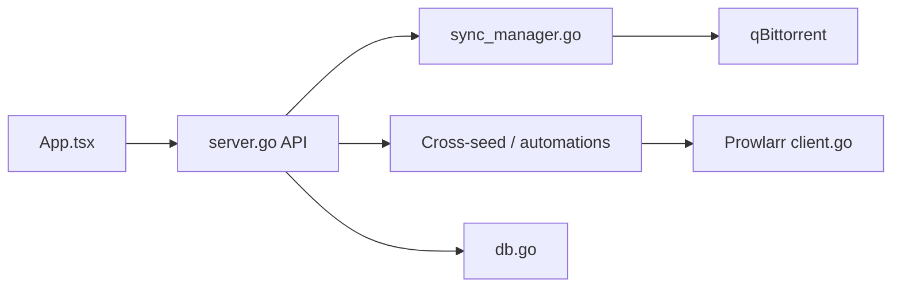

# autobrr/qui

> Lightweight web interface to manage several qBittorrent instances from a single application.

## The problem
Administering several separate qBittorrent clients, with large collections, is slow and scattered.

## What it actually does
A single binary serves an interface that syncs with each qBittorrent instance, with automatic cross-seed, automation rules, scheduled backups and restore, folder scans, transparent reverse proxy and Prowlarr integration. Interface in eleven languages. Premium themes are sold.

## How it is wired


## Trying it
```bash
wget $(curl -s https://api.github.com/repos/autobrr/qui/releases/latest | grep browser_download_url | grep linux_x86_64 | cut -d\" -f4)
sudo tar -C /usr/local/bin -xzf qui*.tar.gz qui
qui serve
docker run -d -p 7476:7476 -v $(pwd)/config:/config ghcr.io/autobrr/qui:latest
```

## Cost and gotchas
Free; premium themes are paid. The README lists cryptocurrency donation addresses: send nothing without verification. GPL-2.0 license.

## What it is not
Not a torrent client: it drives qBittorrent.

## Alternatives
- VueTorrent, iQbit, Flood, qBitController: alternative interfaces cited in the README.

## For you
Ignore: torrent management unrelated to data, AI or MLOps.
