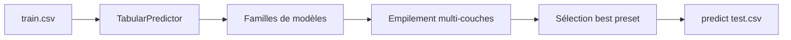

# autogluon/autogluon

> AutoML that selects and stacks models for tabular, time-series and multimodal data.

## The problem
Choosing between classic models and foundation models on tabular data takes days,
and manual model stacking is tedious both to write and to validate.

## What it actually does
Three single-entry predictors: `TabularPredictor`, `TimeSeriesPredictor`, `MultiModalPredictor`.
`fit` takes a CSV and a `label`, trains several model families, stacks them and selects
the best combination through presets (`best`). Backed by a line of publications (TabRepo, Chronos,
Mitra, TabArena, MLZero). Python 3.10 to 3.13, Linux, macOS, Windows.

## How it is wired


## Trying it
```bash
pip install autogluon
```
```python
from autogluon.tabular import TabularPredictor
predictor = TabularPredictor(label="class").fit("train.csv", presets="best")
predictions = predictor.predict("test.csv")
```

## Cost and gotchas
Free locally. GPU support, Conda installs and optional dependencies go through the installation
guide. The recommended cloud deployment (AutoGluon Cloud, DLC containers, SageMaker Autopilot) is billed.

## What it is not
Not a data preparation tool: it expects an already clean dataset with a target column.
Not a transparent box: the `best` preset builds a heavy ensemble, costly at inference.
No license is stated in the README.

## Alternatives
- **Amazon SageMaker Autopilot**: the same engine, managed.
- **AutoGluon Cloud**: recommended by the project for remote training.

## For you
The default reflex for a tabular baseline or a forecast: three lines, solid result.
