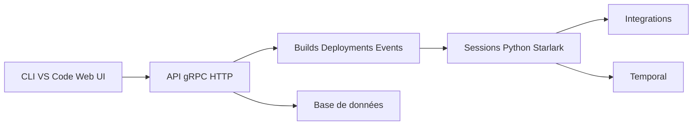

# autokitteh/autokitteh

> Python workflow automation platform, durable thanks to Temporal, self-hosted or cloud (archived repository).

## The problem
No-code tools (Zapier, n8n) limit the logic; writing durable, resumable workflows yourself is complex.

## What it actually does
Go server with a gRPC/HTTP API: projects, builds, deployments, triggers (webhooks, scheduling), sessions run in Python or Starlark (JavaScript announced), integrations (Slack, GitHub, Twilio, ChatGPT, Gemini, Gmail...). Relies on Temporal for durability. CLI, VS Code extension and web interface.

## How it is wired


## Trying it
```bash
git clone https://github.com/autokitteh/autokitteh.git
cd autokitteh
make ak
cp ./bin/ak /usr/local/bin
ak version
```

## Cost and gotchas
Go 1.24 minimum; full builds also require buf and Docker. The cloud offer is in beta, contact by email. Archived repository: no more updates.

## What it is not
It is not an ML tool: it orchestrates general tasks, including MLOps according to the README, with nothing specific to ML.

## Alternatives
- n8n: no-code platform cited by the README.
- Temporal: the durable execution engine AutoKitteh is built on.

## For you
Ignore: archived, so not to be started; for durable orchestration, look at Temporal directly.
