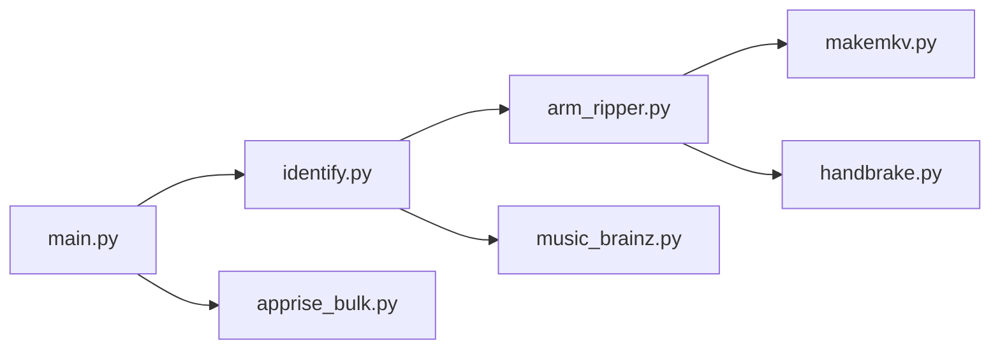

# automatic-ripping-machine/automatic-ripping-machine

> Server that detects an inserted optical disc, identifies it and copies or transcodes it automatically.

## The problem
Digitizing a collection of Blu-ray, DVD and CD discs by hand is slow and repetitive.

## What it actually does
Detects insertion via udev, identifies audio, video or data, names movies via the OMDb API, rips with MakeMKV or HandBrake, CDs with abcde and MusicBrainz, makes an ISO for data discs. Asynchronous transcoding, several drives in parallel, notifications (IFTTT, Slack, Discord...) and a Flask interface to follow the jobs.

## How it is wired

## Trying it
No command documented in the provided README: it points to the wiki for the normal installation, Docker and WSL.

## Cost and gotchas
Free. You need one or more optical drives and a lot of disk space (a NAS is suggested). Identification relies on OMDb.

## What it is not
Not a media library management tool: it produces the files, Plex or Emby read them.

## Alternatives
No alternative cited in the README.

## For you
Ignore: unrelated to data, AI or MLOps; useful only for a personal digitization project.
