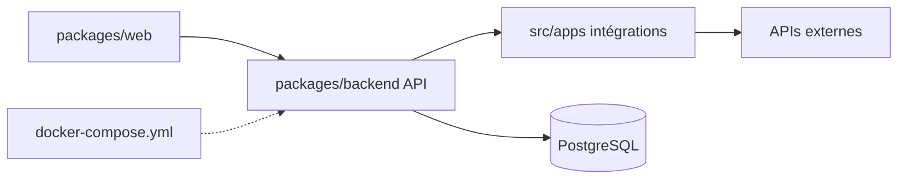

# automatisch/automatisch

> Self-hostable open source alternative to Zapier for automating flows between services, without code.

## The problem
Zapier and Integromat are paid and host your data with a third party, which is a problem for sensitive data or GDPR.

## What it actually does
Web interface (React) and Node.js backend API with PostgreSQL (Knex migrations). A modular "apps" layer, one folder per integration with triggers, actions and authentication. The code mentions "Enterprise" modules (`.ee.` files) under a license separate from the community part (AGPL, according to the architecture).

## How it is wired


## Trying it
```bash
git clone https://github.com/automatisch/automatisch.git
cd automatisch
docker compose up
```

## Cost and gotchas
Free self-hosted. Default credentials `user@automatisch.io` / `sample` must be changed. Last push on 2026-02-11 (more than seven months ago); 289 open issues.

## What it is not
Not a turnkey hosted service; each integration depends on third-party APIs.

## Alternatives
Zapier and Integromat, cited as paid references.

## For you
Worth watching: handy for orchestrating small internal flows, but the license needs clarifying (AGPL and EE) and the commit pace is declining.
