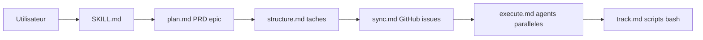

# automazeio/ccpm

> Agent skill that turns PRDs into epics and GitHub issues, with parallel agents, for spec-driven teams.

## The problem
Context is lost between sessions, parallel agents step on each other, and requirements drift when decisions stay verbal.

## What it actually does
A skill (folder `skill/ccpm/`) guides five phases: brainstorm, PRD, epic, task breakdown, GitHub sync. Tasks carry `depends_on`, `parallel`, `conflicts_with`. Files live in `.claude/`. Tracking (standup, status) runs as bash scripts without an LLM. Uses `gh` and one worktree per epic.

## How it is wired


## Trying it
```bash
git clone https://github.com/automazeio/ccpm.git
ln -s /path/to/ccpm/skill/ccpm .claude/skills/ccpm
```
Prerequisites: `git`, `gh auth login`.

## Cost and gotchas
The skill is free; the agents consume your model. The "89% time saved" figures are stated without any method. Sub-issues: the `gh-sub-issue` extension is recommended.

## What it is not
Not an autonomous project management tool: it depends on GitHub Issues. The claimed gains cannot be verified from the README.

## Alternatives
No alternative named in the README.

## For you
Worth watching: the spec → tickets idea is sound, but test it on a small repo before trusting it with real parallel tasks.
