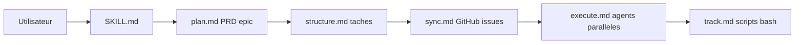

# automazeio/ccpm

> Skill d'agent qui transforme PRD en épopées et issues GitHub, avec agents parallèles, pour équipes pilotées par spécifications.

## Le problème
Le contexte se perd entre sessions, les agents parallèles se marchent dessus, et les exigences dérivent quand les décisions restent orales.

## Ce que ça fait vraiment
Un skill (dossier `skill/ccpm/`) guide cinq phases : brainstorm, PRD, épopée, découpage en tâches, synchronisation GitHub. Les tâches portent `depends_on`, `parallel`, `conflicts_with`. Les fichiers vivent dans `.claude/`. Le suivi (standup, statut) tourne en scripts bash sans LLM. Utilise `gh` et un worktree par épopée.

## Comment c'est branché


## Essayer
```bash
git clone https://github.com/automazeio/ccpm.git
ln -s /path/to/ccpm/skill/ccpm .claude/skills/ccpm
```
Prérequis : `git`, `gh auth login`.

## Coût et pièges
Le skill est gratuit ; les agents consomment ton modèle. Les chiffres « 89 % de temps gagné » sont déclarés sans méthode. Sous-issues : extension `gh-sub-issue` conseillée.

## Ce que ce n'est pas
Pas un outil de gestion de projet autonome : il dépend de GitHub Issues. Les gains annoncés ne sont pas vérifiables d'après le README.

## Alternatives
Aucune alternative nommée dans le README.

## Pour toi
À surveiller : l'idée spec → tickets est saine, mais teste-la sur un petit dépôt avant de lui confier des tâches parallèles réelles.

