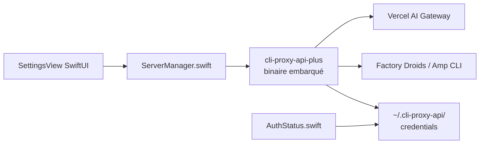

# automazeio/vibeproxy

> macOS menu bar app that exposes your existing AI subscriptions to third-party coding tools.

## The problem
Paying twice: a Claude or ChatGPT subscription on one side, a metered API key on the other.
Handling OAuth, token refresh and routing by hand for each tool.

## What it actually does
Native SwiftUI interface: proxy server start/stop, OAuth authentication for Claude Code,
Codex, Gemini, Kimi, Qwen, Antigravity, and API key for Z.AI GLM.
Multiple accounts per provider with round-robin and failover on rate limit; hot provider
priority. Option to route Claude requests through Vercel's AI Gateway.
Built on CLIProxyAPIPlus, whose binary is embedded in the `.app`.

## How it is wired

## Trying it
No command: download `VibeProxy-arm64.zip` (or `x86_64`) from the Releases,
drag `VibeProxy.app` into `/Applications`, launch it. Build from source: see `INSTALLATION.md`.

## Cost and gotchas
macOS 13+ only, Intel build untested. The app is free but assumes paid subscriptions.
The README itself admits the issue: the AI Gateway is presented as "safer" to avoid
"account risks from using OAuth tokens directly".

## What it is not
It is not a model provider or a neutral proxy: it is a bridge that diverts subscription
tokens to clients not intended by the providers. It is not cross-platform.
It is not the technical core: that is CLIProxyAPIPlus.

## Alternatives
CLIProxyAPIPlus, the underlying proxy, if you do not need the macOS interface.

## For you
Avoid in a professional context: the account and compliance risk is borne by you.
