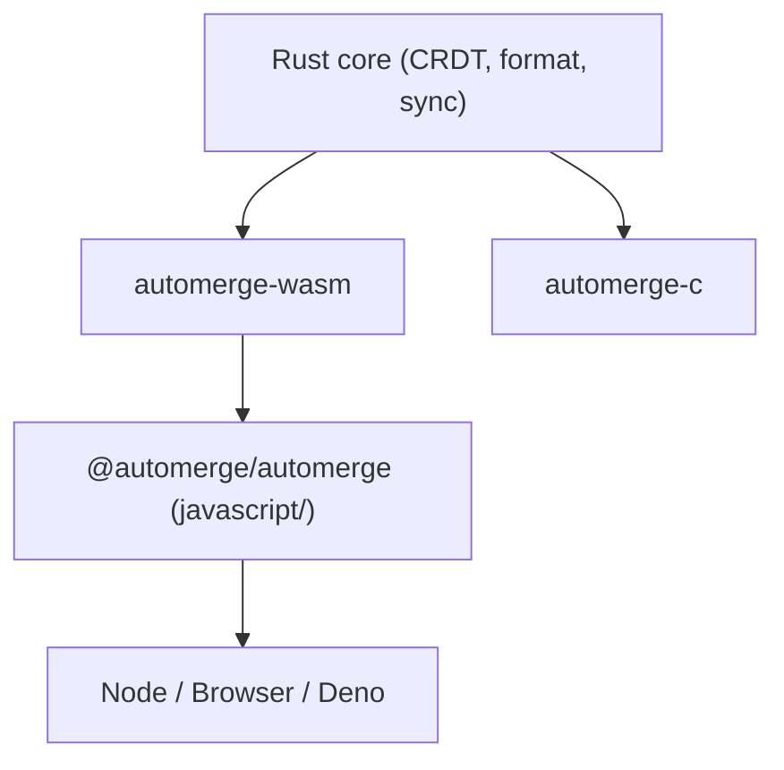

# automerge/automerge

> CRDT library in Rust, exposed in JavaScript/WASM and C, for synchronized local-first applications.

## The problem
Having several people edit the same data offline, then merging without conflict, is a hard distributed systems problem.

## What it actually does
Implements several CRDTs, a compact binary format and a synchronization protocol. The core is in Rust, compiled to WebAssembly for the `@automerge/automerge` package, with a C binding (`rust/automerge-c`). Automerge 3 claims about 10× less memory. The Rust API is described as low-level and sparsely documented.

## How it is wired


## Trying it
```bash
git clone https://github.com/automerge/automerge
cd automerge
npm --prefix ./javascript install
cargo install wasm-bindgen-cli wasm-opt cargo-deny
./scripts/ci/run
```

## Cost and gotchas
Free. Building from source requires Rust (nightly for wasm), Node, cmake and several cargo tools; the npm package avoids this.

## What it is not
Not a database nor a turnkey synchronization server: a data structures library. No networking provided here.

## Alternatives
- autosurgeon: for building Rust applications on top of Automerge.

## For you
Watch: relevant only if you build collaborative local-first tools; of little use for a classic data pipeline.
