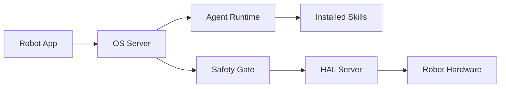

# autonomous-ai/autonomous-os

> Open source operating system for robots, with an agent engine, Markdown skills and a hardware layer.

## The problem
Consumer robots remain remote-controlled or limited to scripted demos.

## What it actually does
A layered software stack: a Go daemon `os-server` (port 5000), a Python HAL (port 5001, 13 declared capabilities), an interchangeable agent engine (Hermes, OpenClaw, PicoClaw, Codex, Claude Code, OpenCode) and real-time voice. Each robot is described by `ROBOT.md`, `SOUL.md`, `SAFETY.md` and `SKILL.md` files. A safety gate, independent of the model, bounds brightness, quiet hours and speed.

## How it is wired


## Trying it
```bash
ssh pollen@reachy-mini.local
curl -fsSL https://raw.githubusercontent.com/autonomous-ai/autonomous-os/main/robots/reachy-mini/install.sh | sudo bash
make os-build && make os-test
make cts
```

## Cost and gotchas
Assumes a compatible robot (Lamp, Reachy Mini, Intern, Pi 4/5 boards, CM4, OrangePi) and the mobile app. The agent engine may require model keys. The safety gate does not cover everything: see `docs/safety.md`.

## What it is not
Not a real-time system: position control stays in the servo firmware. It cannot be installed without hardware.

## Alternatives
No alternative named in the README.

## For you
Ignore: hardware robotics, unrelated to everyday data/MLOps work, except for a specific embedded project.
