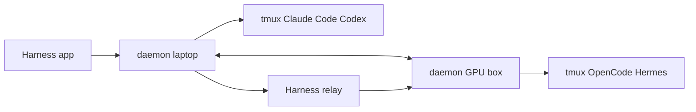

# autonomous-ai/openharness

> Desktop application for driving several coding agents, local or remote, in a single window.

## The problem
Running Claude Code, Codex and other agents on several machines forces you to juggle terminals, SSH and open ports.

## What it actually does
Each agent runs in a tmux pane, with one worktree per session. One daemon per machine connects outward; links go through direct WebRTC or through a relay that only sees ciphertext. A Store offers 49 domain harnesses (Blender, KiCad, marimo, Ollama). A round-screen device is optional.

## How it is wired


## Trying it
```bash
curl -fsSL https://harness.autonomous.ai/cli/install.sh | bash
harness login
harness remote-password set
harness start
```

## Cost and gotchas
Account connection via `harness login`. Each agent keeps its own cost (subscription or API). The install script is run through `curl | bash`. Building: Node 20+, tmux, Xcode, Flutter.

## What it is not
Not an agent: it does not wrap the CLIs but hosts them. No model provided. The relay is a fallback service run by the vendor.

## Alternatives
No alternative named in the README.

## For you
Keep an eye on it: handy for watching agents on a remote GPU machine, but a 2026 project, young and tied to a vendor account.
