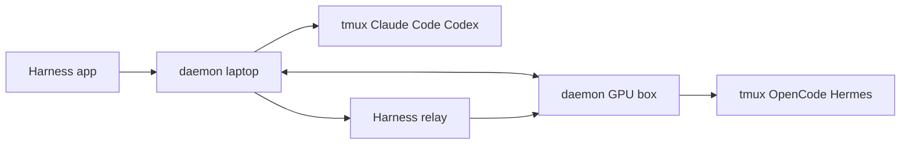

# autonomous-ai/openharness

> Application de bureau pour piloter plusieurs agents de code, locaux ou distants, dans une même fenêtre.

## Le problème
Lancer Claude Code, Codex et d'autres agents sur plusieurs machines oblige à jongler entre terminaux, SSH et ports ouverts.

## Ce que ça fait vraiment
Chaque agent tourne dans un volet tmux, avec un worktree par session. Un démon par machine se connecte vers l'extérieur ; les liaisons passent en WebRTC direct ou via un relais qui ne voit que du texte chiffré. Un Store propose 49 harnesses métier (Blender, KiCad, marimo, Ollama). Un appareil à écran rond est en option.

## Comment c'est branché


## Essayer
```bash
curl -fsSL https://harness.autonomous.ai/cli/install.sh | bash
harness login
harness remote-password set
harness start
```

## Coût et pièges
Connexion à un compte via `harness login`. Chaque agent garde son propre coût (abonnement ou API). Le script d'installation est exécuté via `curl | bash`. Compilation : Node 20+, tmux, Xcode, Flutter.

## Ce que ce n'est pas
Pas un agent : il n'enveloppe pas les CLI mais les héberge. Pas de modèle fourni. Le relais est un service de l'éditeur en repli.

## Alternatives
Aucune alternative nommée dans le README.

## Pour toi
À surveiller : pratique pour surveiller des agents sur une machine GPU distante, mais projet de 2026, jeune et lié à un compte éditeur.

