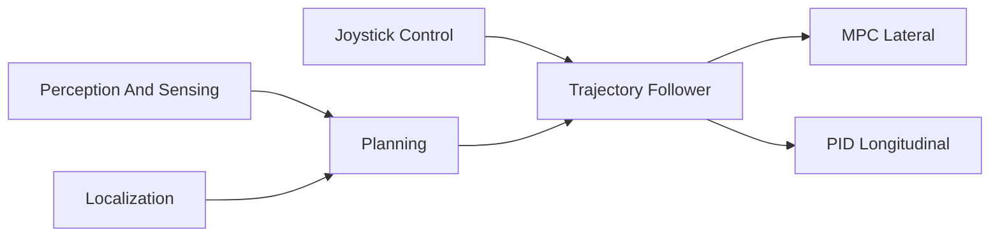

# autowarefoundation/autoware_universe

> Collection of ROS packages for autonomous driving: control, perception, planning, localization, simulation.

## The problem
Building an autonomous driving stack requires dozens of coherent modules (perception, planning, control) that no single project covers.

## What it actually does
Repository of packages extending Autoware Core: control (trajectory follower with lateral MPC, longitudinal PID, pure pursuit), planning (goal planner, speed at intersections), perception (BEVFormer, point cloud concatenation), localization, mode management, and CARLA integration. It is not a single executable. Startup commands are not in the README: it points to the documentation.

## How it is wired


## Trying it
```bash
# Aucune commande documentée dans le README : suivre la documentation Autoware.
```

## Cost and gotchas
Free, but the ecosystem is heavy (ROS, simulator, hardware). 475 open issues.

## What it is not
Not a ready-to-drive application: it is a building block to integrate into the Autoware ecosystem. Coverage badges are not readable here.

## Alternatives
No alternative named in the README.

## For you
Worth watching: interesting if you work on robotic perception or planning, otherwise the integration effort outweighs the gain.
