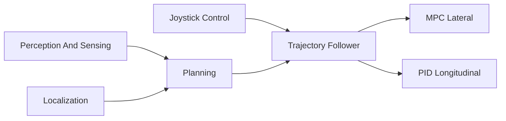

# autowarefoundation/autoware_universe

> Collection de paquets ROS pour la conduite autonome : contrôle, perception, planification, localisation, simulation.

## Le problème
Construire une pile de conduite autonome demande des dizaines de modules cohérents (perception, planning, contrôle) qu'un seul projet ne couvre pas.

## Ce que ça fait vraiment
Dépôt de paquets étendant Autoware Core : contrôle (trajectory follower avec MPC latéral, PID longitudinal, pure pursuit), planification (goal planner, vitesse aux intersections), perception (BEVFormer, concaténation de nuages de points), localisation, gestion de modes, et intégration CARLA. Ce n'est pas un exécutable unique. Les commandes de démarrage ne sont pas dans le README : il renvoie à la documentation.

## Comment c'est branché


## Essayer
```bash
# Aucune commande documentée dans le README : suivre la documentation Autoware.
```

## Coût et pièges
Gratuit, mais l'écosystème est lourd (ROS, simulateur, matériel). 475 issues ouvertes.

## Ce que ce n'est pas
Pas une application prête à conduire : c'est une brique à intégrer dans l'écosystème Autoware. Les badges de couverture ne sont pas lisibles ici.

## Alternatives
Aucune alternative nommée dans le README.

## Pour toi
À surveiller : intéressant si tu touches à la perception ou au planning robotique, sinon l'effort d'intégration dépasse le gain.

