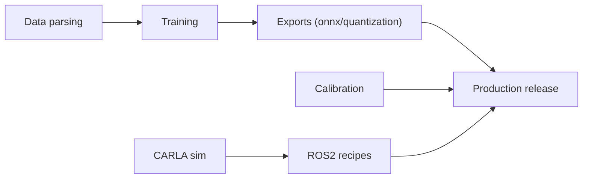

# autowarefoundation/autoware_vision_pilot

> Open source single-camera level 2 driver-assistance stack, for carmakers and equipment suppliers.

## The problem
Level 2 ADAS systems are closed and costly to reproduce, which slows research and integration.

## What it actually does
The repository contains a C++ ADAS stack (cruise control, emergency alert and braking, lane keeping, speed assistance) and three models: AutoSpeed, AutoSteer, AutoDrive. It works with a monocular camera, without an HD map. Based on the code, `Models/` groups PyTorch training, ONNX export and quantization, and `VisionPilot/` the runtime with ROS2, Zenoh, IceOryx2, CARLA and calibration.

## How it is wired


## Trying it
```bash
cd VisionPilot
mkdir build && cd build
cmake -DONNXRUNTIME_ROOT=<ONNX_RUNTIME_ROOT_PATH> ../
make
./VisionPilot
sudo apt install ./VisionPilot-1.0-x86_64.deb
```

## Cost and gotchas
The GPU path requires CUDA; CARLA requires a GPU with enough VRAM (an adaptation is indicated below 6 GB). You must download ONNX Runtime and the sample data separately, and calibrate your camera for correct measurements.

## What it is not
Not a homologated product: the README speaks of a "certifiable" base, without providing any certification. The repository keeps several generations of the runtime (0.9, 1.0, production), which blurs reading.

## Alternatives
No alternative named in the README.

## For you
Worth watching: interesting to see a full chain of training, ONNX export and embedded runtime, but only if you work on automotive perception.
