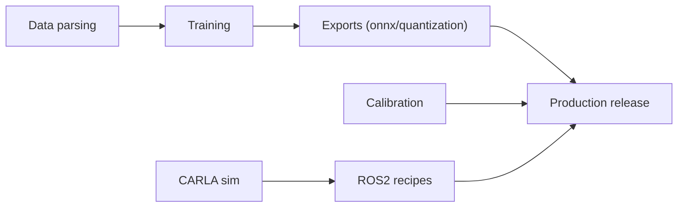

# autowarefoundation/autoware_vision_pilot

> Pile open source d'aide à la conduite de niveau 2 à une caméra, pour constructeurs et équipementiers.

## Le problème
Les systèmes ADAS de niveau 2 sont fermés et coûteux à reproduire, ce qui freine la recherche et l'intégration.

## Ce que ça fait vraiment
Le dépôt contient une pile ADAS en C++ (régulateur, alerte et freinage d'urgence, maintien de voie, assistance de vitesse) et trois modèles : AutoSpeed, AutoSteer, AutoDrive. Elle fonctionne avec une caméra monoculaire, sans carte HD. D'après le code, `Models/` regroupe l'entraînement PyTorch, l'export ONNX et la quantification, et `VisionPilot/` le runtime avec ROS2, Zenoh, IceOryx2, CARLA et la calibration.

## Comment c'est branché


## Essayer
```bash
cd VisionPilot
mkdir build && cd build
cmake -DONNXRUNTIME_ROOT=<ONNX_RUNTIME_ROOT_PATH> ../
make
./VisionPilot
sudo apt install ./VisionPilot-1.0-x86_64.deb
```

## Coût et pièges
Le chemin GPU demande CUDA ; CARLA exige un GPU avec assez de VRAM (une adaptation est indiquée sous 6 Go). Il faut télécharger ONNX Runtime et les données d'exemple séparément, et calibrer ta caméra pour des mesures correctes.

## Ce que ce n'est pas
Ce n'est pas un produit homologué : le README parle d'une base « certifiable », sans fournir de certification. Le dépôt garde plusieurs générations du runtime (0.9, 1.0, production), ce qui brouille la lecture.

## Alternatives
Aucune alternative nommée dans le README.

## Pour toi
À surveiller : intéressant pour voir une chaîne complète entraînement, export ONNX et runtime embarqué, mais seulement si tu touches à la perception automobile.

