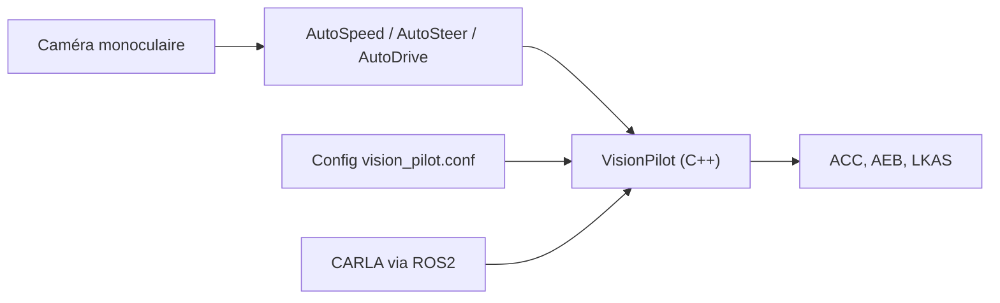

# autowarefoundation/vision_pilot

> Open source single-camera level 2 driver-assistance stack; same content as autoware_vision_pilot.

## The problem
Level 2 ADAS systems are closed and costly to reproduce, which slows research and integration.

## What it actually does
The README is identical to that of `autowarefoundation/autoware_vision_pilot` (same creation date, same stars, same last push): it is most likely the same project under another name, although the text does not say so. It describes a level 2 ADAS stack: cruise control, emergency alert and braking, lane keeping, speed assistance, with three models (AutoSpeed, AutoSteer, AutoDrive) and a monocular camera.

## How it is wired
Simplified diagram based on the sheet, no diagram provided.


## Trying it
```bash
git clone https://github.com/autowarefoundation/autoware_vision_pilot.git
cd VisionPilot
mkdir build && cd build
cmake -DONNXRUNTIME_ROOT=<ONNX_RUNTIME_ROOT_PATH> ../
make
./VisionPilot
```

## Cost and gotchas
The README itself clones `autoware_vision_pilot`: check which repository is the reference before relying on it. The GPU path requires CUDA, and CARLA a card with enough VRAM. You need to calibrate your camera.

## What it is not
Not a homologated product, and this repository brings no content of its own based on the material provided. No architecture description based on the code is provided for it.

## Alternatives
`autowarefoundation/autoware_vision_pilot`, cited by the README as the cloned repository.

## For you
Ignore in favor of `autoware_vision_pilot`: same text, and it is better to follow a single reference repository.
