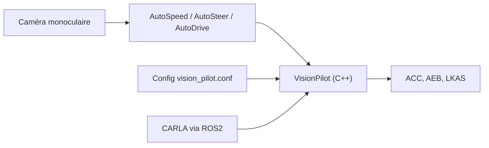

# autowarefoundation/vision_pilot

> Pile open source d'aide à la conduite de niveau 2 à une caméra ; même contenu que autoware_vision_pilot.

## Le problème
Les systèmes ADAS de niveau 2 sont fermés et coûteux à reproduire, ce qui freine la recherche et l'intégration.

## Ce que ça fait vraiment
Le README est identique à celui de `autowarefoundation/autoware_vision_pilot` (même date de création, mêmes étoiles, même dernier push) : il s'agit vraisemblablement du même projet sous un autre nom, sans que le texte le dise. Il décrit une pile ADAS niveau 2 : régulateur, alerte et freinage d'urgence, maintien de voie, assistance de vitesse, avec trois modèles (AutoSpeed, AutoSteer, AutoDrive) et une caméra monoculaire.

## Comment c'est branché
Schéma simplifié d'après la fiche, sans diagramme fourni.


## Essayer
```bash
git clone https://github.com/autowarefoundation/autoware_vision_pilot.git
cd VisionPilot
mkdir build && cd build
cmake -DONNXRUNTIME_ROOT=<ONNX_RUNTIME_ROOT_PATH> ../
make
./VisionPilot
```

## Coût et pièges
Le README lui-même clone `autoware_vision_pilot` : vérifie quel dépôt est la référence avant de t'y fier. Le chemin GPU demande CUDA, et CARLA une carte avec assez de VRAM. Il faut calibrer ta caméra.

## Ce que ce n'est pas
Ce n'est pas un produit homologué, et ce dépôt n'apporte pas de contenu propre d'après les éléments fournis. Aucune description d'architecture d'après le code n'est fournie pour lui.

## Alternatives
`autowarefoundation/autoware_vision_pilot`, cité par le README comme dépôt cloné.

## Pour toi
À ignorer en faveur de `autoware_vision_pilot` : même texte, et mieux vaut suivre un seul dépôt de référence.

